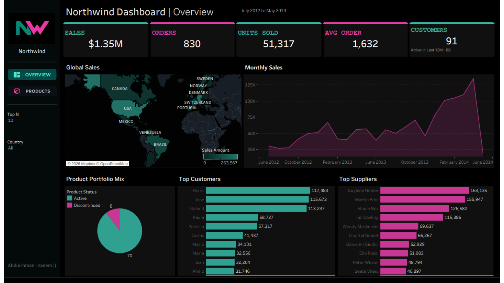
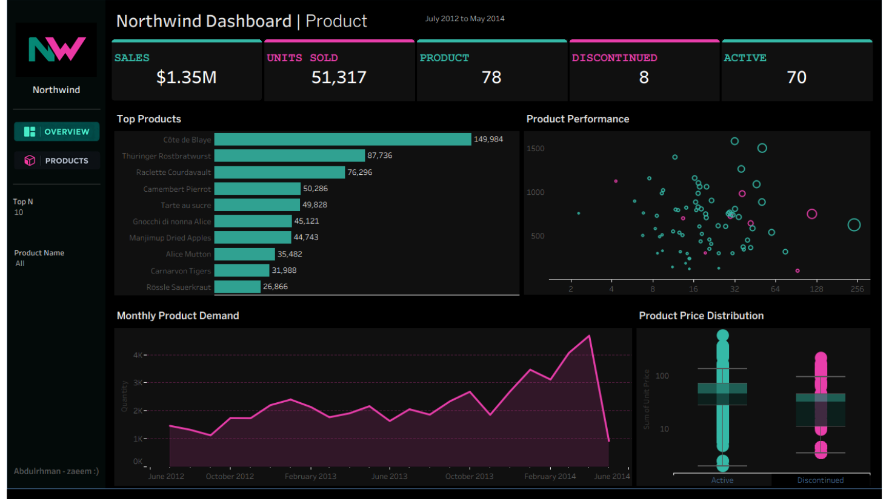

<p align="center">
  
</p>

<h1 align="center">Northwind Sales Dashboard</h1>

<p align="center">
  An interactive, dark-themed <b>Tableau</b> dashboard analysing sales, customers, suppliers and products
  on the classic Northwind dataset (July 2012 – May 2014).
</p>

<p align="center">
  
  
  
</p>

---

## Preview

### Overview page



### Product page



## About the project

The dashboard answers four business questions:

1. **How are we doing overall?** Sales, orders, units, average order value and customer count at a glance.
2. **Where does the money come from?** Sales by country (map), top customers and top suppliers.
3. **How does it move over time?** Monthly sales and monthly product demand.
4. **Which products matter?** Best sellers, active vs. discontinued mix, price spread and product performance.

It has **two pages** (Overview and Product), a custom sidebar with image-button navigation,
and interactive filters (**Country**, **Product Name**, **Top N** parameter).

## Key numbers

| Metric              | Value                                    |
| ------------------- | ---------------------------------------- |
| Total sales         | **$1.35M** ($1,354,459)                  |
| Orders              | **830**                                  |
| Units sold          | **51,317**                               |
| Average order value | **1,632**                                |
| Customers           | **91** (88 active in the last 12 months) |
| Products            | **78** (70 active, 8 discontinued)       |

## What the data shows

- **Sales are concentrated geographically.** The USA ($263.6K, 19.5%) and Germany ($244.6K, 18.1%) lead, and the top 3 countries (adding Austria) make up about **48%** of sales.
- **A few customers carry a lot of revenue.** The top 3 customers generate roughly **26%** of sales and the top 10 about **45%**.
- **One product dominates.** _Côte de Blaye_ alone brings in about **$150K (11%)**.
- **Discontinued products still matter.** They are 8 of 78 products (about 10%) but account for about **15%** of historical sales.
- **Strong growth into 2014.** The peak month is **April 2014 ($134.6K)**.
- **Data caveat:** the last order is dated **6 May 2014**, so May 2014 is a _partial_ month. The sharp drop at the end of both line charts is an artefact of incomplete data, not a real collapse.

## Repository structure

```
northwind-tableau-dashboard/
├── README.md
├── LICENSE
├── .gitignore
├── .gitattributes
├── data/
│   └── Northwind.xlsx                       # source data (6 sheets)
├── tableau/
│   └── Northwind_Dashboard_v2026_1.twbx     # packaged workbook (data + images included)
├── assets/
│   ├── logo.png
│   ├── buttons/                             # navigation button images
│   │   ├── overview_button.png
│   │   └── products_button.png
│   └── screenshots/                         # images used in this README
│       ├── overview.png
│       └── product.png
└── docs/
    ├── data-model.md                        # tables, relationships, calculated fields
    ├── Northwind_Dashboard.pdf              # static export of both pages
    └── Northwind_Dashboard.pptx             # slide version
```

## How to open it

1. Install **Tableau Desktop 2026.2 or newer** (the workbook was saved with build 2026.2.3).
2. Download `tableau/Northwind_Dashboard_v2026_1.twbx`.
3. Double-click it. A `.twbx` is a _packaged_ workbook, so the data and images are already inside and nothing else is needed.

> To refresh the data, use **Data → Edit Data Source** and point it at `data/Northwind.xlsx`.
> The Global Sales map uses Mapbox tiles, so an internet connection is needed for the background map.

## Data model

Five tables from the Northwind dataset are related in Tableau:

`Customer` → `Orders` → `OrderItem` → `Product` → `Supplier`

Full details (columns, keys and every calculated field) are in [docs/data-model.md](docs/data-model.md).

## Design

- Dark theme with a **teal** and **magenta/pink** accent palette, taken from the Northwind logo.
- Fixed canvas of **1400 × 800** for consistent layout.
- KPI cards, a map, area/line charts, bar charts, a pie, a bubble chart and a box plot, all built with standard Tableau marks.

## Tools

- Tableau Desktop (dashboards, calculated fields, parameters, dashboard actions)
- Microsoft Excel (source data)

## Author

**Abdulrhman Nasser**

## License

Released under the [MIT License](LICENSE). The Northwind sample dataset originates from Microsoft's sample databases and is used here for educational and portfolio purposes.
